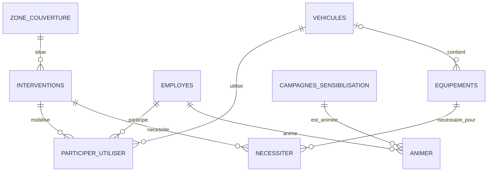

# Modèle de données - FireStation Manager

Le modèle physique Oracle est défini dans [`../database/oracle_schema.sql`](../database/oracle_schema.sql). Il suit le modèle demandé par l'équipe. Le seul module Qt implémenté dans ce projet est la gestion des véhicules ; les autres tables sont présentes dans Oracle pour l'application complète.

## Modèle Entité / Association

`PARTICIPER_UTILISER` est une association ternaire entre employé, véhicule et intervention. `EQUIPEMENTS.IMMATRICULATION` est facultative : un équipement peut être affecté à zéro ou un véhicule. `NECESSITER` et `ANIMER` matérialisent des associations plusieurs-à-plusieurs.

## Modèle relationnel

- **ZONE_COUVERTURE**(**ID_ZONE**, NOM, REGION, SUPERFICIE, POPULATION, NIVEAU_RISQUE, TEMPS_INTERVENTION)
- **EMPLOYES**(**ID_EMPLOYE**, NOM_PRENOM, GRADE, SPECIALITE, TELEPHONE, MOT_DE_PASSE)
- **VEHICULES**(**IMMATRICULATION**, TYPE, ETAT, MODELE, KILOMETRAGE, DERNIERE_MAINTENANCE)
- **EQUIPEMENTS**(**ID_EQUIPEMENT**, CATEGORIE, QUANTITE, ETAT, DATE_PEREMPTION, IMMATRICULATION FK nullable)
- **CAMPAGNES_SENSIBILISATION**(**ID_CAMPAGNE**, TITRE, THEME, DATE_CAMPAGNE, LIEU, PUBLIC_CIBLE, NOMBRE_PARTICIPANTS)
- **INTERVENTIONS**(**ID_INTERVENTION**, TYPE_INTERVENTION, ADRESSE, DATE_INTERVENTION, HEURE, GRAVITE, STATUT, ID_ZONE FK)
- **PARTICIPER_UTILISER**(**ID_EMPLOYE** FK, **IMMATRICULATION** FK, **ID_INTERVENTION** FK)
- **NECESSITER**(**ID_EQUIPEMENT** FK, **ID_INTERVENTION** FK)
- **ANIMER**(**ID_EMPLOYE** FK, **ID_CAMPAGNE** FK)

Les séquences et déclencheurs Oracle 11g génèrent les identifiants numériques. L'immatriculation est la clé primaire métier de `VEHICULES` et reste modifiable via le CRUD Qt.

## Périmètre Qt

`VehiculeModel` centralise les requêtes préparées d'ajout, affichage, modification et suppression sur `VEHICULES`. Les écrans des autres entités ne font pas partie du module Qt demandé, mais leurs tables et associations sont créées par le script commun.
